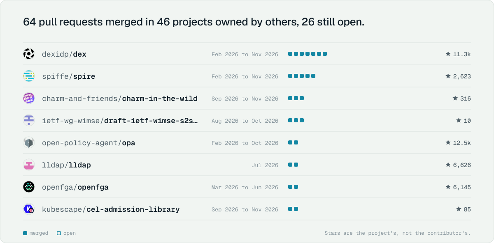
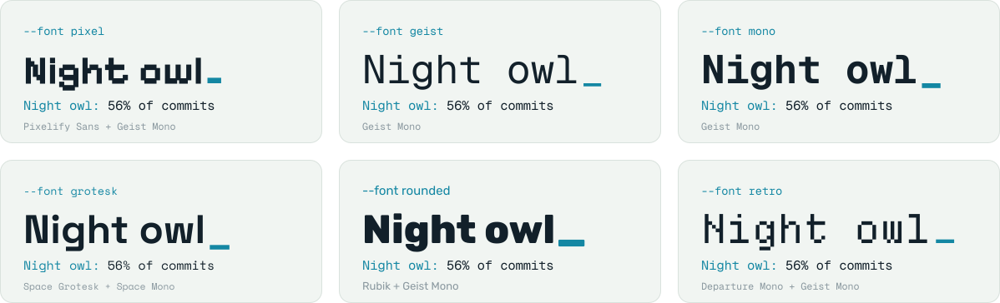

# gitsona

[](https://www.npmjs.com/package/gitsona) [](https://github.com/kanywst/gitsona/actions/workflows/ci.yml)

**Your GitHub profile README, drawn from what you actually do.**

<picture>
  <source media="(prefers-color-scheme: dark)" srcset="docs/example/hero-dark.svg">
  
</picture>

It reads your public activity and draws it as a terminal running `gitsona <you>`: your year as ASCII terrain, and the facts as fetch-style rows that type themselves in. Four of them say what sets you apart, each backed by a number. Under the card go the one-sentence summary, your latest repos and your last merged upstream PR. That's the whole profile: one screen, so your pins and contribution graph show right below. Nothing is hosted: the images are plain files in your own repo and make no outside requests. The examples here are the author's profile, drawn from live data.

## Two steps to your profile

1. **Look.** `npx gitsona --preview`, then open `<you>/gitsona-preview.html`.
2. **Ship.** `npx gitsona --push --action` commits it to your `<you>/<you>` repo (asks first), with a workflow that redraws it every day. Leave out `--action` to redraw by hand.

The token comes from `GITSONA_TOKEN`, `GITHUB_TOKEN`, `GH_TOKEN`, or `gh auth token`, and gitsona draws the account behind it. To draw someone else, name them: `npx gitsona octocat --preview`.

## Want more?

`--sections all` adds five panels under the card, or name the ones you want, in order: `traits`, `rhythm`, `projects`, `strata`, `upstream`.

<picture>
  <source media="(prefers-color-scheme: dark)" srcset="docs/example/rhythm-dark.svg">
  
</picture>

<picture>
  <source media="(prefers-color-scheme: dark)" srcset="docs/example/upstream-dark.svg">
  
</picture>

## Pick a typeface

<picture>
  <source media="(prefers-color-scheme: dark)" srcset="docs/fonts/presets-dark.svg">
  
</picture>

`--font pixel` is the default. `--display-font your.otf` swaps in your own face for the name and headlines. The bundled faces are under the SIL Open Font License.

## Options

| Option | Effect |
| --- | --- |
| `--preview` | Also write `gitsona-preview.html`, framed like a GitHub profile with a light/dark switch |
| `--push` | Create `<you>/<you>` if needed, commit and push. `-y` skips the questions |
| `--action` | Add a workflow that redraws the profile every day. `--schedule weekly` for Mondays only |
| `--sections <list>` | `all`, or pick and order panels, such as `hero,rhythm` |
| `--font <name>` | `pixel`, `geist`, `mono`, `grotesk`, `rounded` or `retro` |
| `--accent <hex>` | Accent colour. Defaults to your top language's colour |
| `--private` | Count private repos in language and topic stats. Their names are never drawn |
| `--bio` | Repeat your GitHub bio under the card. The sidebar already shows it |

`npx gitsona --help` lists the rest. Output goes to `./<you>`, or to `.` inside a `<you>/<you>` checkout; `-o` changes it.

## Re-running

- Only the block between `<!-- gitsona:start -->` and `<!-- gitsona:end -->` is redrawn. Anything you write outside it stays. A README without the markers keeps its old content below the new block; `--replace` overwrites the whole file instead.
- The scheduled workflow redraws with the options of the run that wrote it (`--sections`, `--font`, `--accent`, `--bio` and so on), commits only when something changed, and stays on the gitsona version that wrote it. Run `--action` again to upgrade. For private contribution counts, add a token with repo read access as the `GITSONA_TOKEN` secret.

## Notes

- Images make no outside requests. Text is drawn as glyph outlines shaped with HarfBuzz, since GitHub's image CSP can block embedded fonts. Characters outside the chosen faces, such as a name in kanji, fall back to the viewer's system font.
- The GitHub mobile app ignores `<picture>` and always shows the light images.
- Upstream counts merged PRs in repositories owned by others: not you, and not an organization you belong to. Organizations whose membership the token can't see (private membership with the default Actions token) count as others'. Add `GITSONA_TOKEN` with `read:org` to leave them out.
- Commit search covers default branches only, and the rhythm panel samples up to 100 commits per month: it describes habits, not totals.

## Development

```sh
bun install
bun test
bun src/cli.ts <user> --preview
# SVG to PNG with headless Chromium
scripts/shot.sh out/<user>/gitsona/*.svg
# redraw docs/fonts/presets-*.svg
bun scripts/specimens.ts
```

To try unreleased `main`: `npx --allow-git=all github:kanywst/gitsona` (npm 12 and later need the flag).

## License

MIT. The bundled fonts are under the SIL Open Font License 1.1; see `fonts/`.
