# gitsona

Draws your GitHub profile README from what you actually do on GitHub. One command, no hosted service.

```sh
npx gitsona
```

To run the unreleased code on `main` instead, use `npx --allow-git=all github:kanywst/gitsona`. `--allow-git=all` is needed on npm 12 and later, which refuses packages fetched from git by default. Older npm ignores it.

It reads your public activity, works out what you build and how you work, and writes a `README.md` and a folder of SVGs to `./<you>`. Push that folder to your `<you>/<you>` repository and it shows on your profile.

<picture>
  <source media="(prefers-color-scheme: dark)" srcset="docs/example/hero-dark.svg">
  
</picture>

The example above and below is the author's own profile, drawn from live data.

## What it draws

| Section | What it shows | Where it comes from |
| --- | --- | --- |
| Hero | Headline, one-line summary, four numbers, and the last 12 months as contour relief | Topics and descriptions of your repos, languages by bytes, contribution calendar |
| Working style | Own repos or upstream, specialist or generalist, in bursts or every day, few or many projects | Each spectrum prints the numbers that placed the marker |
| Rhythm | Weekday by hour of your commits, and commits per month | A year of commit search, read in each commit's own time zone |
| Projects | Cards for notable repositories you have not pinned, since GitHub shows pins right below | Stars, releases, recent pushes and fit with your main domains |
| Languages over time | The language mix of repositories created each year | Language bytes per repository |
| Upstream | Projects owned by others where your pull requests were merged | PR search, with your own organizations left out |

<picture>
  <source media="(prefers-color-scheme: dark)" srcset="docs/example/traits-dark.svg">
  
</picture>

<picture>
  <source media="(prefers-color-scheme: dark)" srcset="docs/example/rhythm-dark.svg">
  
</picture>

<picture>
  <source media="(prefers-color-scheme: dark)" srcset="docs/example/upstream-dark.svg">
  
</picture>

## Usage

```sh
npx gitsona [user] [options]
```

With no user, it draws the account behind your token. The token comes from `GITHUB_TOKEN`, `GH_TOKEN`, or `gh auth token`.

| Option | Effect |
| --- | --- |
| `-o, --out <dir>` | Output directory. Defaults to `./<user>`, or `.` inside a `<user>/<user>` checkout |
| `--preview` | Also write `gitsona-preview.html`, a local page framed like a GitHub profile with a light/dark switch |
| `--push` | Create `<user>/<user>` if needed, commit and push. Asks before each step unless `-y` |
| `--action` | Add a weekly workflow that redraws the profile |
| `--sections <list>` | Pick and order sections: `hero,traits,rhythm,projects,strata,upstream` |
| `--font <name>` | Typeface preset, see below. Defaults to `pixel` |
| `--display-font <file>` | Use your own `.ttf` or `.otf` for the name and headlines |
| `--accent <hex>` | Accent colour. Defaults to your top language's colour |
| `--private` | Let private repositories count toward language and topic stats. Their names are never drawn |
| `--no-motion` | Skip the contour draw-in on the hero |
| `--no-cursor` | Leave out the accent `_` after your name |
| `--save-raw <file>`, `--from-raw <file>` | Save the fetched data, or render from it without calling GitHub |

`gitsona --help` lists everything.

## Typefaces

Six presets ship with the package, all under the SIL Open Font License. The first face sets the name and headlines, the second the text and numbers.

| `--font` | Faces |
| --- | --- |
| `pixel` | Pixelify Sans, Geist Mono |
| `geist` | Geist Mono and Geist, Geist Mono |
| `mono` | Geist Mono throughout |
| `grotesk` | Space Grotesk, Space Mono |
| `rounded` | Rubik throughout |
| `retro` | Departure Mono, Geist Mono |













## Re-running

The generated part of `README.md` sits between `<!-- gitsona:start -->` and `<!-- gitsona:end -->`. Anything you write outside those markers stays. A README without markers keeps its old content below the new block; `--replace` overwrites it instead.

With `--action`, a workflow redraws the profile every Monday and commits only when something changed. It runs the gitsona version that wrote it, so a new release never changes your profile on its own; run `--action` again to move to it. The default `GITHUB_TOKEN` sees public activity. For private contribution counts, add a token with read access to your repositories as the `GITSONA_TOKEN` secret.

## Notes

- The images make no outside requests. Text is drawn as glyph outlines shaped with HarfBuzz, because GitHub serves README images under a CSP that can block embedded fonts. Characters outside the chosen faces, such as a name in kanji, fall back to the viewer's system font.
- The GitHub mobile app ignores `<picture>` and always shows the light images.
- Commit search only covers default branches. The rhythm panel is a sample of up to 100 commits per month, so it describes habits, not totals.

## Development

```sh
bun install
bun test
bun src/cli.ts <user> --preview
scripts/shot.sh out/<user>/gitsona/*.svg
```

`scripts/shot.sh` renders SVGs to PNG with headless Chromium for a visual check.

## License

MIT. The bundled fonts are under the SIL Open Font License 1.1; see `fonts/`.
