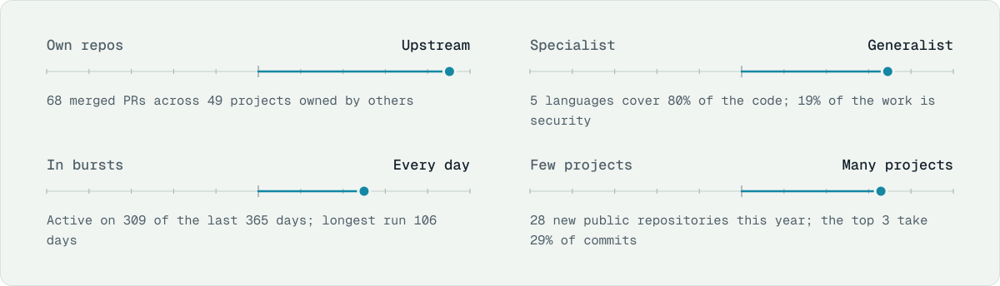
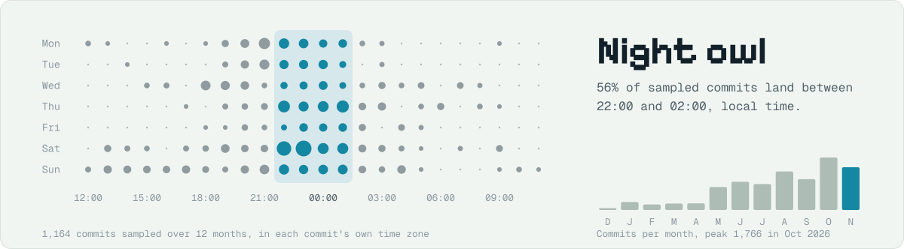

# gitsona

[](https://www.npmjs.com/package/gitsona) [](https://github.com/kanywst/gitsona/actions/workflows/ci.yml)

**Your GitHub profile README, drawn from what you actually do.**

<picture>
  <source media="(prefers-color-scheme: dark)" srcset="docs/example/hero-dark.svg">
  
</picture>

It reads your public activity, works out what you build and how you work, and writes a `README.md` plus SVGs for your profile repo. Nothing is hosted: the images are plain files in your own repo and make no outside requests. The examples here are the author's profile, drawn from live data.

## Two steps to your profile

1. **Look.** `npx gitsona --preview`, then open `<you>/gitsona-preview.html`.
2. **Ship.** `npx gitsona --push --action` commits it to your `<you>/<you>` repo (asks first), with a workflow that redraws it every Monday. Leave out `--action` to redraw by hand.

The token comes from `GITSONA_TOKEN`, `GITHUB_TOKEN`, `GH_TOKEN`, or `gh auth token`, and gitsona draws the account behind it. To draw someone else, name them: `npx gitsona octocat --preview`.

## What it finds

**How you work.** Four spectra, each with the numbers that placed the marker.

<picture>
  <source media="(prefers-color-scheme: dark)" srcset="docs/example/traits-dark.svg">
  
</picture>

**When you work.** Weekday by hour, read in each commit's own time zone.

<picture>
  <source media="(prefers-color-scheme: dark)" srcset="docs/example/rhythm-dark.svg">
  
</picture>

**Where you give back.** Merged pull requests in projects owned by others.

<picture>
  <source media="(prefers-color-scheme: dark)" srcset="docs/example/upstream-dark.svg">
  
</picture>

Plus project cards for notable repos you haven't pinned, and your language mix year by year. All six (`hero`, `traits`, `rhythm`, `projects`, `strata`, `upstream`) are drawn by default; `--sections` picks and orders them.

## Pick a typeface

<picture>
  <source media="(prefers-color-scheme: dark)" srcset="docs/fonts/presets-dark.svg">
  
</picture>

`--font pixel` is the default. `--display-font your.otf` swaps in your own face for the name and headlines. The bundled faces are under the SIL Open Font License.

## Options

| Option | Effect |
| --- | --- |
| `--preview` | Also write `gitsona-preview.html`, framed like a GitHub profile with a light/dark switch |
| `--push` | Create `<you>/<you>` if needed, commit and push. `-y` skips the questions |
| `--action` | Add a weekly workflow that redraws the profile |
| `--sections <list>` | Pick and order sections, such as `hero,rhythm` |
| `--font <name>` | `pixel`, `geist`, `mono`, `grotesk`, `rounded` or `retro` |
| `--accent <hex>` | Accent colour. Defaults to your top language's colour |
| `--private` | Count private repos in language and topic stats. Their names are never drawn |

`npx gitsona --help` lists the rest. Output goes to `./<you>`, or to `.` inside a `<you>/<you>` checkout; `-o` changes it.

## Re-running

- Only the block between `<!-- gitsona:start -->` and `<!-- gitsona:end -->` is redrawn. Anything you write outside it stays. A README without the markers keeps its old content below the new block; `--replace` overwrites the whole file instead.
- The weekly workflow commits only when something changed, and stays on the gitsona version that wrote it. Run `--action` again to upgrade. For private contribution counts, add a token with repo read access as the `GITSONA_TOKEN` secret.

## Notes

- Images make no outside requests. Text is drawn as glyph outlines shaped with HarfBuzz, since GitHub's image CSP can block embedded fonts. Characters outside the chosen faces, such as a name in kanji, fall back to the viewer's system font.
- The GitHub mobile app ignores `<picture>` and always shows the light images.
- Commit search covers default branches only, and the rhythm panel samples up to 100 commits per month: it describes habits, not totals.

## Development

```sh
bun install
bun test
bun src/cli.ts <user> --preview
scripts/shot.sh out/<user>/gitsona/*.svg   # SVG to PNG with headless Chromium
bun scripts/specimens.ts                   # redraw docs/fonts/presets-*.svg
```

To try unreleased `main`: `npx --allow-git=all github:kanywst/gitsona` (npm 12 and later need the flag).

## License

MIT. The bundled fonts are under the SIL Open Font License 1.1; see `fonts/`.
